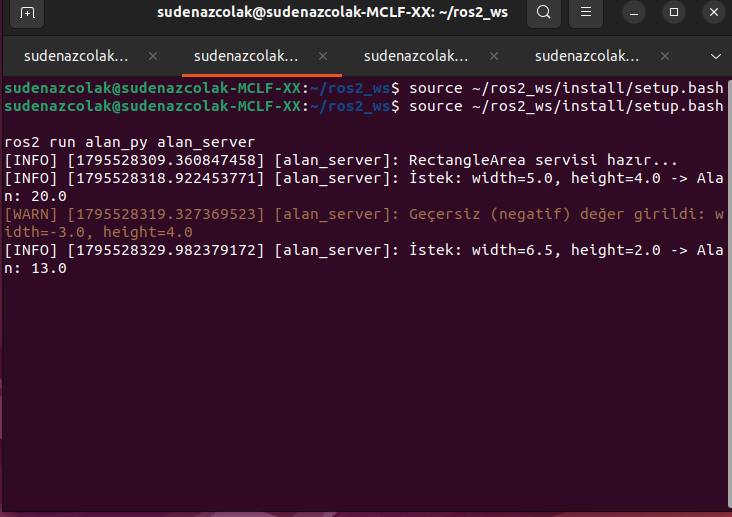
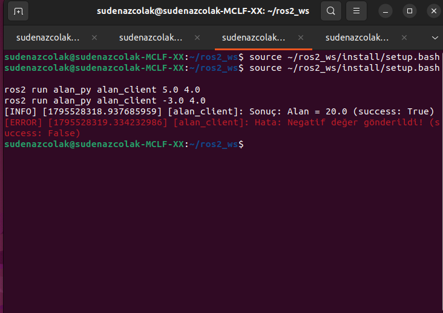
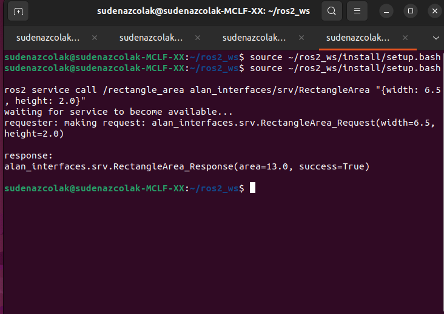

# RectangleArea ROS 2 Servis Ödevi

Bu depo `alan_interfaces` (özel servis arayüzü) ve `alan_py` (sunucu ve istemci düğümleri) paketlerini içerir.

## Kurulum ve Derleme Komutları
```bash
cd ~/ros2_ws
colcon build --packages-select alan_interfaces alan_py
source install/setup.bash
```

## Çalıştırma Komutları
**Sunucu:**
```bash
ros2 run alan_py alan_server
```

**İstemci:**
```bash
ros2 run alan_py alan_client 5.0 4.0
```

## Doğrulama (`ros2 service call`) ve Çıktısı
```bash
ros2 service call /rectangle_area alan_interfaces/srv/RectangleArea "{width: 6.5, height: 2.0}"
```
**Çıktı:**
```text
requester: making request: alan_interfaces.srv.RectangleArea_Request(width=6.5, height=2.0)

response:
alan_interfaces.srv.RectangleArea_Response(area=13.0, success=True)
```

---

## Çalışma Ekran Görüntüleri ve Açıklamaları

### 1. Sunucu Düğümü (`alan_server`)

* **Açıklama:** `alan_server` düğümü başlatılarak `/rectangle_area` servisi aktif hale getirilmiştir. İstemciden gelen geçerli pozitif değerler (`width=5.0, height=4.0` ve `width=6.5, height=2.0`) için dikdörtgen alanı doğru şekilde hesaplanıp yanıt olarak döndürülmüş; negatif değer içeren istek (`width=-3.0, height=4.0`) ise uyarı (`WARN`) verilerek reddedilmiştir.

### 2. İstemci Düğümü (`alan_client`)

* **Açıklama:** Komut satırı argümanları ile çalıştırılan `alan_client` düğümü ile iki farklı test gerçekleştirilmiştir. Pozitif değerlerle yapılan ilk çağrıda `Alan = 20.0 (success: True)` sonucu alınmış, negatif değer girilen ikinci çağrıda ise servis doğrulama kontrolü devreye girerek `Hata: Negatif değer gönderildi! (success: False)` çıktısı üretilmiştir.

### 3. Komut Satırı Servis Doğrulaması (`ros2 service call`)

* **Açıklama:** Çalışan sunucu düğümüne terminal üzerinden doğrudan `ros2 service call` komutu ile `{width: 6.5, height: 2.0}` isteği gönderilmiş ve servisin `area=13.0, success=True` yanıtını döndürdüğü doğrulanmıştır.
